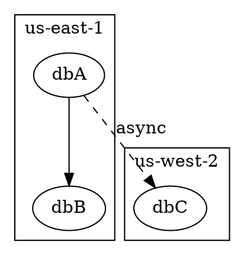

# output

Go packages for producing program output in more than one shape: aligned
text, CSV, JSON or YAML, chosen when the program runs — while the program
is still working, live progress on the terminal — and charts, drawn in the
terminal in braille or as a picture, and diagrams of boxes and the lines
between them. The `plot` command draws a chart from a CSV file, and `diagram`
a diagram from Graphviz's DOT language.

`table` builds tabular data and renders it as aligned text.

```go
import "github.com/wisborg/output/table"

t := table.New(
    table.Column{Header: "clip"},
    table.Column{Header: "offset", Align: table.Right, Format: "%+.2fs"},
    table.Column{Header: "score", Align: table.Right, Format: "%.3f"},
)
t.MustAppend("corner_1", 2.70, 0.821)
t.MustAppend("corner_3", 2.75, 0.366)

fmt.Print(t)
```

```
clip       offset   score
-------------------------
corner_1   +2.70s   0.821
corner_3   +2.75s   0.366
```

`Style{Frame: true}` draws it in the style of the `mysql` client;
`Style{Multiline: true}` gives each line of a multi-line cell its own row;
`Style{Spacing: n}` sets the gap between columns.

The same table writes CSV, over the same rows:

```go
t.WriteCSV(os.Stdout, table.CSVStyle{})
```

```
clip,offset,score
corner_1,+2.70s,0.821
corner_3,+2.75s,0.366
```

`Align` and `MaxWidth` do not apply there — padding and truncation are
concessions to a fixed-width display, and silently shortening a value on its
way into a file someone will compute with is how you lose it. `Format` does
apply, because that is you saying how the value should be written. Separators
are skipped, and an empty table still writes its header, where the text
renderer writes nothing: a program reading CSV usually needs that line.

## Choosing the format when the program runs

The root package writes one result in whichever format was asked for. The
premise is that the program builds **two** representations of that result and
lets the format choose between them:

```go
import "github.com/wisborg/output"

doc := output.Document{
    Data:  results, // the object: for JSON and YAML
    Table: summary, // the simplified table: for text and CSV
}
if err := doc.Write(os.Stdout, format); err != nil {
    return err
}
```

They are built independently on purpose. Deriving one from the other forces
the richer shape through the poorer one and makes both worse: JSON grows
stringly-typed cells and pre-formatted numbers, while the table grows columns
nobody wanted to read on a terminal. Writing both is a few lines in the
program that has the data, and each comes out shaped for its reader — the
object can carry the checksum and the detector settings, the table can show
three columns and stop.

A `Document` only needs the representation the chosen format uses: JSON of a
document with no `Table` is fine, CSV of one with no `Data` is fine. Asking
for a format whose representation is missing is an error naming the format —
`ErrNoData` or `ErrNoTable` — and nothing is written. Nothing is written on
any other failure either: whatever the format, the output is either empty or
a whole document ending in a newline — exactly one, but where YAML's last
value is a string ending in newlines of its own, which it keeps. A table with **no rows**
is not a missing table: it is a supplied answer that happens to be empty, and
it keeps `table`'s own rules, so text writes nothing and CSV writes its
header.

`Format` is a `flag.Value`, so the flag is one line and an unknown name is
refused where the user typed it rather than quietly falling back to text:

```go
format := output.Text // the default; the zero Format is Text
flag.Var(&format, "format", "output format: text, csv, json or yaml")
```

`text`, `csv`, `json` and `yaml`, case-insensitively, plus `table` for text
and `yml` for YAML. `Format(99)`, from a cast or a decoded config file, is an
error too: there is no `default:` arm falling through to text, because a
program that prints a table when its caller asked for JSON has produced
output that cannot be parsed and no message saying why.

### JSON and YAML

`WriteJSON` and `WriteYAML` are the same encoders without the `Document`, for
a program that has only the object. Both end their output with exactly one
newline, as text and CSV do.

JSON is indented two spaces by default, and **does not escape HTML**, which
inverts `encoding/json`'s default. That default is right when the JSON is
embedded in a web page and wrong here: a URL in a CLI's output should read
`https://x/?a&b`, not `https://x/?a\u0026b`, which stays wrong when the
reader copies it out of their terminal. `JSONStyle{EscapeHTML: true}` puts it
back. Marshalling errors are wrapped, not flattened, so
`errors.As(err, new(*json.UnsupportedTypeError))` still reaches the type that
could not be encoded.

YAML is indented two spaces, against the library's default of four, and gets
no `---` marker for a single document. `YAMLStyle{Indent: n}` takes 2 to 9,
which is the emitter's own range: it *resets* anything outside that to 2
rather than clamping to the nearer bound, so `Indent: 10` would produce
output identical to never having set it. That is refused with an error naming
the value and the range, rather than being clamped to 9 — a quieter version
of the same surprise.

`WriteYAML` writes all of a document or none of it. The encoder streams, so a
value it rejects part-way through would otherwise leave tens of kilobytes of
truncated YAML on the writer; the document is rendered into a buffer first
and copied out only once it is known to be good. That keeps the invariant
above true for every format instead of true for three of them.

Two things about YAML are worth knowing before you offer it as a format:

- The library **panics** on a type it cannot marshal — a channel or a
  function — where `encoding/json` returns an error. `WriteYAML` recovers
  that one panic and returns an error naming the type. The recovery is
  narrow: any other panic is re-raised, because anything else is a bug in the
  encoder and swallowing it would hide it.
- A **cyclic value still takes the process down**, and cannot be fixed here.
  The encoder follows pointers with no visited set, so a value pointing back
  at itself is encoded again at every level, for ever. It does not fail
  quickly: it spins, emitting an ever-deeper nesting of the same data and
  consuming CPU and memory without bound, until the buffer cannot grow or the
  recursion overflows the stack — and a stack overflow in Go is fatal, not a
  panic, not recoverable. `encoding/json` detects cycles and reports them as
  errors, so the same `Document` that writes as JSON can take the program
  down as YAML. Break cycles before handing data to any encoder.

Both encoders sort mapping keys their own way — `encoding/json` alphabetically
for maps and in declaration order for structs, the YAML library likewise —
and this package adds no knob for that.

## Three decisions worth knowing about

**Cells are stored as you pass them, and formatted only when rendered.** An
`int` stays an `int` until there is a table to draw. That is what allows a
column's alignment, format verb or width limit to be changed after its rows
are already in place — the thing you most often want, because you learn what
a column holds by looking at it:

```go
t.Columns[1].Align = table.Right
```

It is also what leaves room for renderers other than text. CSV shares this row
model exactly. JSON and YAML deliberately do not: they are far more flexible
than a grid of cells, so forcing them through a row-and-column model would
make both worse. They read a separate data source instead — see below — and
are never derived from a table.

**Column widths are measured in terminal columns, not bytes or runes.** These
are three different numbers. `len("café")` is 5 or 6 depending on whether the
`é` is precomposed; `utf8.RuneCountInString("日本語")` is 3 where the terminal
uses 6; an emoji with a skin-tone modifier is two runes and one glyph. Getting
this wrong produces a table that looks correct until someone's data is not
ASCII. The measure is `Table.Width`, defaulting to
[`runewidth.StringWidth`](https://github.com/mattn/go-runewidth), and it is a
field you can replace:

```go
t.Width = utf8.RuneCountInString // fine for ASCII and precomposed Latin
```

**An empty table renders as nothing** — not a lone header over blank space,
which reads as data that failed to load. Only the caller knows what "no rows"
means for them, so only the caller should say it.

## Status

Text and CSV in `table`; text, CSV, JSON and YAML through `output.Document`;
live progress bars in `progress`; charts in braille, as pictures and in the
terminal's picture protocols in `chart` and its packages; diagrams from
Graphviz's DOT, as text, PNG and SVG, in `diagram` and its packages; and the
two commands built on them, `plot` and `diagram`.

JSON and YAML are still not *table* renderers, and that is the same decision
as before rather than a reversal of it: nothing converts a table into an
object, there is no row accessor for a converter to use, and asking a
`Document` for JSON reads `Data` and never looks at `Table`. What has been
added is the other data source that argument always implied, and the
dispatch that picks between the two.

The API is not yet frozen.

## Dependencies

Three, all compatible with this project's Apache-2.0 licence, and recorded
with their notices in [NOTICE](NOTICE), which a program shipping these
packages carries along:

- [`mattn/go-runewidth`](https://github.com/mattn/go-runewidth) (MIT), for
  display-width measurement, which in turn uses
  [`clipperhouse/uax29`](https://github.com/clipperhouse/uax29) (MIT).
- [`go.yaml.in/yaml/v3`](https://github.com/yaml/go-yaml) (**MIT and
  Apache-2.0** — the eight files ported from libyaml are MIT, the rest is
  Apache-2.0, and there is a NOTICE file), for YAML. This is the YAML
  organisation's maintained fork of `gopkg.in/yaml.v3`, which was archived in
  April 2025. It has no dependencies of its own.
- [`golang.org/x/image`](https://pkg.go.dev/golang.org/x/image) (BSD-3-Clause),
  for drawing a chart or a diagram as a picture: its vector rasteriser and the
  Go Mono font it embeds, whose licence is the same BSD-style one as Go's. It
  uses `golang.org/x/text` (BSD-3-Clause).

`table` does not import the YAML library, so a program that only builds
tables does not link it; `chart` imports nothing outside the standard library;
`diagram` measures its labels with `go-runewidth`, as `table` does; and only
`chart/picture` and `diagram/picture` import `golang.org/x/image`, so a program
that draws charts or diagrams in text, or as SVG, or not at all, does not link
that. `make deps` checks all of this.

## progress

`progress` puts one or more bars at the bottom of a terminal and lets ordinary
output scroll above them, so a program can log and show progress at once.

```go
import "github.com/wisborg/output/progress"

d := progress.New(os.Stderr, progress.Options{})
defer d.Stop()

bar := d.Bar(progress.BarSpec{Label: "rendering", Total: 10800, Unit: "frames"})
for i := 0; i < 10800; i++ {
    render(i)
    bar.Set(int64(i + 1))
}
```

```
info  merged 5 files into one activity
warn  clip-0043 has no GPS fixes
rendering  ▕███████████████████████▍                 ▏   56%  6100/10800 frames  7375/s  ~1m02s left
encoding   ▕████████▏                                ▏   19%  2100/10800 frames  3688/s  ~2m21s left
```

A bar counting bytes says so with `Bytes: true`, and writes its counts and rate with binary
prefixes rather than as a count of units:

```
map data   ▕██████████▉                              ▏   31%  297.5/945.0 MiB  3.4 MiB/s  ~3m12s left
```

**A `Display` is an `io.Writer`.** That is the whole mechanism for the two
living together: a write erases the bars, emits the line, and redraws beneath
it. Any logger over an `io.Writer` composes with it, which is why this package
contains no logger of its own.

```go
log := slog.New(slog.NewTextHandler(d, nil))
```

**It degrades on its own.** When the writer is not a terminal — redirected,
piped, or a platform it cannot ask — it emits plain periodic lines with no
escape sequences at all, so `program 2>log` collects a readable log rather
than a file full of cursor movements. A caller does not branch on where its
output is going.

```
rendering 44% 4800/10800 frames 7482/s
encoding 22% 2300/10800 frames 3585/s
```

**The fill can be coloured.** A `Palette` chooses between no colour (the zero
value), one colour, or a gradient across the trough.

```go
d := progress.New(os.Stderr, progress.Options{Palette: progress.DefaultGradient()})

// or
progress.SolidPalette(progress.RGB{R: 0x22, G: 0xC5, B: 0x5E})
progress.GradientPalette(from, to)
```

Only the fill is coloured — the brackets, the label and the numbers are left in
the terminal's own foreground, which is what its user chose for reading. Colour
is emitted only on a live display whose terminal will take it: never in plain
mode, never when `NO_COLOR` is set or `TERM=dumb`, and 24-bit sequences only
where `COLORTERM` claims them, falling back to the 256-colour palette
everywhere else. So it is safe to ask for unconditionally.

**The trough is a fixed width.** Each field's room is reserved before the run
starts — including for the rate and the estimate, which only appear once there
is enough work to measure them — so the bar does not shrink as the counts gain
a digit or lurch when those fields arrive. A width that turns out to be too
small grows once and never shrinks back, so the trough can narrow but never
oscillate.

**Bars never wrap.** A live line that exceeded the terminal's width would
occupy two rows while the erase arithmetic counted one, and the display would
then eat the log above it on every redraw. Lines are measured in terminal
columns and a bar with too little room drops fields from the right instead.

A job whose `Total` is unknown reports its count and rate and shows no
percentage, no estimate and no empty trough: a bar that never fills reads as
one that is stuck rather than as a measurement nobody has.

`Bar.Set` is meant to be called once per unit of work — it does not allocate
when it is not redrawing — and a nil `*Display` is usable and does nothing, so
a `--quiet` flag is one decision at construction rather than a condition at
every call site.

## chart

`chart` draws one or several series of readings against time or any other x
axis, stacked one above the other on a shared axis: in braille, which any
terminal shows, or — with `chart/picture` — as an image, which `chart/terminal`
shows in a terminal that can show one (iTerm2 and WezTerm, kitty and Ghostty).

```go
import "github.com/wisborg/output/chart"

segments := chart.Segments(points, 2*time.Minute) // the line breaks at a gap longer than this
lo, hi, _ := chart.RobustRange(segments)
c := chart.Chart{
    Title:  "load (%) against time",
    X:      chart.ExactScale(0, 3600, 4, chart.Clock),
    Strips: []chart.Strip{{Title: "load (%)", Y: chart.NewScale(lo, hi, 4, chart.Number), Segments: segments}},
    BandKinds: []chart.BandKind{{Name: "maintenance", Mark: '━'}},
    Bands:     []chart.Band{{From: 600, To: 1200, Kind: 0}},
}
for _, line := range c.Braille(44, 12) {
    fmt.Println(line)
}
```

```
load (%) against time
100┤⠀⠀⠀⠀⠀⠀⠀⠀⣀⣀⣀⣀⣀⠀⠀⠀⠀⠀⠀⠀⠀⠀⠀⠀⠀⠀⠀⠀⠀⠀⠀⠀⠀⠀⠀⠀⠀⠀⠀⠀
   │⠀⠀⠀⠀⣀⡤⠞⠉⠁⠀⠀⠀⠀⠀⠀⠀⠀⠀⠀⠀⠀⠀⠀⠀⠀⠀⠀⠀⠀⠀⠀⠀⠀⠀⠀⠀⠀⠀⠀⠀
   │⠀⣀⡴⠋⠁⠀⠀⠀⠀⠀⠀⠀⠀⠀⠀⠀⠀⠀⠀⠀⠀⠀⠀⠀⠀⠀⠀⠀⠀⠀⠀⠀⠀⠀⠀⠀⠀⠀⠀⠀
 50┤⠞⠁⠀⠀⠀⠀⠀⠀⠀⠀⠀⠀⠀⠀⠀⠀⠀⠀⠀⠀⠀⠀⠀⠀⠀⠀⠀⠀⠀⠀⠀⠀⠀⠀⠀⠀⠀⠀⠀⠀
   │⠀⠀⠀⠀⠀⠀⠀⠀⠀⠀⠀⠀⠀⠀⠀⠀⠀⠀⠀⠀⠀⠀⠀⠒⢦⡀⠀⠀⠀⠀⠀⠀⠀⠀⠀⠀⠀⠀⣀⡴
   │⠀⠀⠀⠀⠀⠀⠀⠀⠀⠀⠀⠀⠀⠀⠀⠀⠀⠀⠀⠀⠀⠀⠀⠀⠀⠉⠳⠤⣄⡀⠀⠀⠀⠀⣀⡤⠴⠋⠁⠀
  0┤⠀⠀⠀⠀⠀⠀⠀⠀⠀⠀⠀⠀⠀⠀⠀⠀⠀⠀⠀⠀⠀⠀⠀⠀⠀⠀⠀⠀⠀⠉⠉⠉⠉⠉⠁⠀⠀⠀⠀⠀
   └┬────────┬─────────┬─────────┬─────────┬
    0:00   0:15      0:30      0:45     1:00
           ━━━━━━
    ━ maintenance
```

The decisions that make a chart truthful are made once, in `chart`, and every
rendering follows them:

- **A missing reading is never a zero.** A line breaks where its readings stop
  for longer than the tolerance the caller gives `Segments`, and a column with
  no reading is left blank rather than dropped to the bottom.
- **The y axis is set from where most readings lie.** `RobustRange` leaves the
  highest and lowest hundredth out, so a dropout or a spike does not flatten the
  rest; a reading beyond the axis is drawn at its edge.
- **Ticks fall on round numbers, or round times** for a `Clock` scale — 15 s,
  5 min, 1 h — or, for a `Date` scale, where a calendar marks them: the hour,
  the day, the first of the month, the year. A date's tick is written as
  briefly as the one beside it allows — `Mar`, and January as `2024` — the
  first in full. Numbers on an axis stepping by a hundred thousand or more are
  written `250k`, `4M`. The x axis spans the series exactly rather than being
  rounded out to the next tick.
- **A band is the chart's, not a strip's:** a stretch the chart marks is marked
  in every strip, faintly behind the line in a picture and in a row of marks
  beneath the axis in braille, two bands a character apart kept apart.

`picture.Draw` draws the same chart as an image in a `Palette` — `Light` and
`Dark` are given — in Go Mono, with fonts of the caller's to fall back on.
`terminal.Choose` says how to show it: a picture where the terminal is known to
show one and the output is that terminal, braille in a pipe, a file, tmux or
screen, where a picture's escape sequence would arrive as a page of base64.
`terminal.SizeOf` says how big the terminal is, in pixels too where it says,
and `terminal.LightBackground` whether its background is light, by
`COLORFGBG`.

## plot

`plot` charts columns of a CSV file — prices against dates, rain against
months, anything — with the packages above.

```
go install github.com/wisborg/output/cmd/plot@latest

plot prices.csv                          # every column of numbers against the first
plot --y close,volume prices.csv         # these columns, a strip each
plot --x month --y rain --out rain.png weather.tsv
some-program | plot --smooth 7           # from standard input, a 7-row average
plot --list prices.csv                   # what each column holds
```

It reads values delimited by commas, tabs, semicolons or bars — it tells which
by looking, or `--delimiter` says — quoted where they hold the delimiter, with
or without a first row of names. A number may be written with a decimal point,
`1,234.5`, or with a decimal comma, `1.234,5`, as a spreadsheet writes one
where a comma is the decimal mark. Which a file uses is told once for the whole
file, from numbers in it that read only one way -- `0,5` only with a comma,
`1,234,567` only with a point -- and a file written both ways is refused. Where
no number says, a file delimited by semicolons is read with a comma and any
other with a point, and `plot` notes a number it read that could have been
read the other way, as `1,234` can. `--decimal point` or `comma` says outright.
A column is plotted by name or by number.
Without `--x` the first column is the axis where it holds dates, or numbers in
order; otherwise the row is. Dates are read in ISO 8601's forms, with month
names, and in numbers alone — `03/04/2024` — whose day and month are told
apart by a day past the 12th, or by `--dates dmy` or `mdy` where none is; and
as logs and databases write a moment, `2024-03-05 14:30:15 +0100`, `…+0100`
without the colon, `… UTC`, `…+01`. A column of numbers that are dates —
seconds since 1970, milliseconds, or `20240305` — is read as one with
`--x-date unix`, `unix-ms` or `yyyymmdd`, since a number cannot say so itself.

The rows are drawn in the axis's order, so a file written newest first is
drawn oldest first. An empty cell, `NA` or `null` is a gap in the line, never
a zero, and a cell that is not a number in a column of them is a gap too,
which `plot` says. The y axis spans every value unless `--robust` asks for the
middle 98%: a spike in someone's data is as likely to be the point as an
error.

In iTerm2, WezTerm, kitty and Ghostty the chart is a picture the width of the
window; in any other terminal, in tmux, or into a pipe, it is braille; with
`--out` it is a PNG. CSV is the only format it reads for now: the reading is
one file of the command, and another format is another reader of the same
table.

`--width` and `--height` in the terminal are taken as given, not held to the
window. Braille is drawn whole before a line of it is written, and has no
ceiling as a PNG has: its memory grows with the width, about 500 MB at a
million characters, so a mistyped width can take the machine's memory
before anything is drawn. A picture's pixels are held to a few thousand
across, but the terminal is still asked to show it as many columns wide as
`--width` says, past the window's edge if that is wider.

## diagram

`diagram` lays out and draws diagrams — a flow chart, a database cluster and
its replicas, services and what they call — as text in the terminal, or with
`diagram/picture` as a PNG and `diagram/svg` as SVG. `diagram/dot` reads them
from Graphviz's [DOT language](https://graphviz.org/doc/info/lang.html), so a
diagram can be written in a language many people know, or taken from a
program that already writes DOT.

```
go install github.com/wisborg/output/cmd/diagram@latest

diagram cluster.dot                 # in the terminal: a picture, or text in colour
diagram --out cluster.png cluster.dot     # 1600 pixels wide, as plot's charts
diagram --out cluster.svg --width 800 cluster.dot
some-program --graph | diagram
```

[`examples/replication.dot`](examples/replication.dot) is a worked example
of everything below: regions as lanes, databases filled by their health, and
a legend saying what the colours and lines mean.
[`examples/friday-deploy.dot`](examples/friday-deploy.dot) is a flow chart,
laid out in layers from its edges, on whether to deploy on a Friday
afternoon.
[`examples/services.dot`](examples/services.dot) is a mesh of services
drawn with straight edges.

A group of nodes — a DOT subgraph whose name begins with `cluster` — places
what it holds in one of two ways. Without anything more, in **layers**, as
Graphviz's `dot` does: each node below the nodes its edges come from, the
branches of a step either side of it. That is what a flow chart wants. With
`columns=N` or `rows=N` — attributes of this package's own, which Graphviz
ignores, so the file still draws there — in a **grid**, in the order the
nodes are written, with `row=` and `col=` to pin one to a cell. A grid's
places come from what the diagram declares, never from its edges, so a
diagram of a system draws every box where it was when a link changes: a
replica that stops replicating moves nothing, and its line is all that
differs. `style=lane` draws a cluster as a band across the diagram, set off
from the next by a line, as a region or a data centre is:



```
┌─────┐      ┌─────┐
│ dbA ├─────▶│ dbB │    us-east-1
└──┬──┘      └─────┘
   ╎
───┼─────────────────────────────
   ▼ async
┌─────┐
│ dbC │                 us-west-2
└─────┘
```

Grids stacked in a grid share their columns, as a table's rows do, so `dbC`
is under `dbA` though the lanes are laid out apart.

`style=legend` makes a cluster the diagram's **legend** instead of a part of
it: a frame below the diagram, outside every grid and layer, so it moves
nothing and nothing moves it. Each node in it is an entry — a swatch filled
and outlined as the node would be, or, for a node of `shape=plain`, a short
line in its colour and style, as an edge is drawn — beside its label:

```dot
  subgraph cluster_legend {
    label = "Legend"; style = legend
    healthy [label = "healthy", style = filled, fillcolor = "#8fd18f"]
    failing [label = "error",   style = filled, fillcolor = "#f08a8a"]
    async   [label = "asynchronous replication", shape = plain, style = dashed]
  }
```

```
┌─ Legend ─────────────────────────┐
│                                  │
│  ████  healthy                   │
│  ████  error                     │
│  ╌╌╌╌  asynchronous replication  │
│                                  │
└──────────────────────────────────┘
```

In a terminal the text drawing is in colour — a node's fill behind it, the
swatches in theirs — unless `--color never` says otherwise, `NO_COLOR` is
set, or it is going into a pipe or a file.

Everything is measured in character cells, so the text drawing and the
pictures are one layout: a picture draws each cell as a fixed box of pixels
in a monospaced font. Every edge runs along rows and columns, round a box in
its way rather than through it — except, in a PNG or an SVG, where the DOT
sets Graphviz's `splines` (`splines = line`, say), or `--edges straight`
asks: then an edge is one straight line between its boxes, at whatever
angle, wherever that line is clear of the other boxes. That suits a mesh of
services more than a flow chart. `--edges orthogonal` turns it off whatever
the file says. The text drawing keeps such edges along rows and columns
unless `--braille thin` or `--braille thick` asks for them at their angle,
in braille dots one or two deep, as plot draws its charts; each ends in the
usual arrowhead, on a one-cell stub into its box.

A box's place comes from the grid or the layers; a line's from the router,
which a port steers. Graphviz's compass points say which side of its box an
edge leaves or enters by — `a:s -> b:n` leaves `a` from its bottom and
enters `b` from its top, as do `tailport = s` and `headport = n` — and no
box moves for them. Where an edge has both, its own `tailport` is taken
over `a:s`, and `a:s` over an `edge [tailport = …]` default, as Graphviz
takes them. `n`, `e`, `s` and `w` are a side each; a corner, `ne`
say, is either side of it, since a line never ends on a box's corner; `c`
and `_` are any side. An edge with a port is drawn along rows and columns
in a picture with straight edges too. Where no line can leave or enter by
the side asked for without joining another's line or passing through a
box, that end is drawn by another side, the other end keeping its own
where it can, and `diagram` says which edge.

Shapes are boxes, rounded boxes, ellipses,
cylinders and plain text; lines solid, dashed, dotted or bold; colours
Graphviz's, by `#rrggbb` or by the common X11 names.

Of DOT, the whole grammar is read, and the attributes that say what a
diagram means; those about how Graphviz draws are ignored. HTML labels are
read as their words, a port naming a record's field is read and not drawn,
as a record shape is not; an edge ending at a
cluster itself (Graphviz's `lhead` and `ltail`), record shapes and
Graphviz's other layout engines are not supported.

A DOT file is often someone else's, and a few bytes of it can ask for hours
of layout: one statement joining two sets of nodes makes an edge for every
pair. So a file may make at most 300 edges, and a laid-out page have at most
a million cells; `--max-edges` and `--max-cells` (`dot.Options` and
`diagram.LayoutOptions` in the library) raise them for a genuine diagram past
them.

## Licence

Apache License 2.0 — see [LICENSE](LICENSE).
